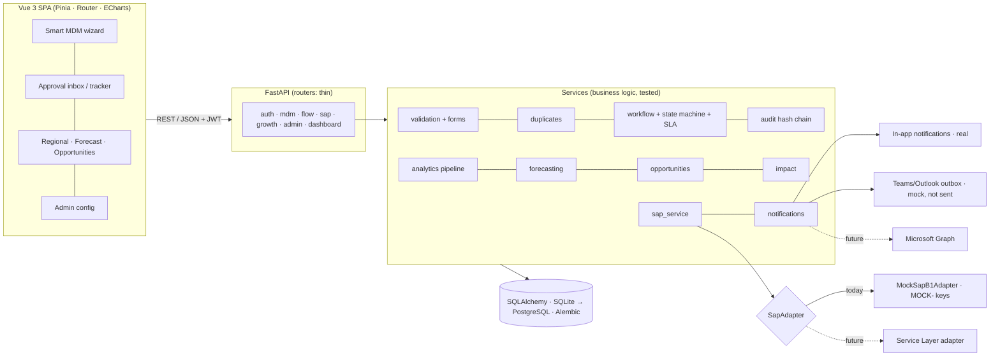
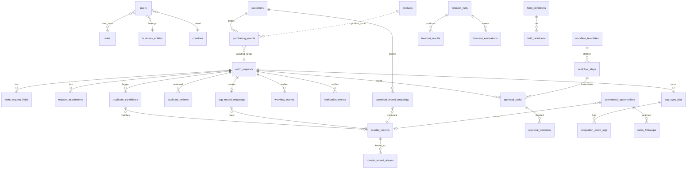
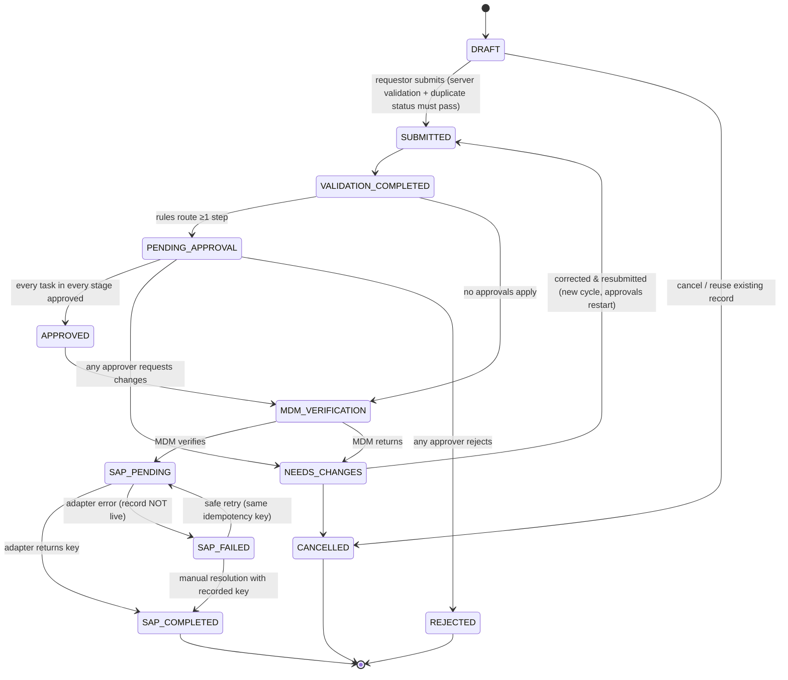

# LIVES ONE — Architecture & Design

This document answers the design questions before the code: what the brief requires, what we propose, how it is built,
and how every feature traces to a pain point and a judging criterion. Diagrams use Mermaid (render on GitHub).

## 1. Case requirements extracted from the brief

**Facts we rely on (brief):** Singapore-HQ healthcare/life-sciences distributor; five country locations in SEA; entities
SPD, QTS, QTG sharing one SAP B1 instance; master data = Business Partners (customers, vendors), Items, Cost Centers; core
Products A, B, C; Microsoft 365 (Outlook, Teams) is the collaboration backbone; a final record must land in SAP B1; no dedicated
IT team beyond a small window; new BUs/product lines a few times a year; banking and credit fields are sensitive; approvers are
BU Heads, Finance, Quality/Regulatory, Business Support; a small MDM team keys records into SAP B1; forecasting uses rolling
6–12-month purchase-order history.

**Pain points (brief §4):** no standard intake; duplicates ("National University Hospital"); no status visibility; serial
email approvals (2–3 weeks); no reliable approval record; sensitive fields in email; IT needed for every form/approver change;
manual rolling-average forecasts missing cross-sell, seasonal shifts and drop-off; fragmented records across SPD/QTS/QTG
preventing a clean regional view.

**Deliverables (brief §7):** working prototype + 2–3 min video showing the connection to SAP B1; a regional business view of
purchase-request/order volumes and growth for A/B/C across five locations over a stated 6–12 months with a defined growth
measure, how DS/AI improves forecasting or productivity, implications and actions, and a clear distinction between
purchase requests/orders and MDM set-up requests; a two-page/two-slide summary with cost/effort and adoption.

**What is proposed by us (not mandated):** everything in this repository — the form designs, routing rules, SLAs, scoring
thresholds, models, synthetic data and country allocation are prototype design choices, recorded in
[`ASSUMPTIONS.md`](ASSUMPTIONS.md).

**Deliberately not built in v1 (brief §5 last prompt):** record *maintenance* (update) requests, bulk imports, a general
no-code workflow engine (ordinal stages + conditions cover the stated needs), ML-based duplicate scoring (explainable rules
are easier to trust and tune with little labelled data), seasonal or deep-learning forecasts (12 months cannot support them),
automatic inventory/procurement changes, and real SAP/M365 calls (credentials and mapping must first be confirmed).

## 2. Architecture



**Data flows.** (1) Request → validation → duplicate check → routing → approvals → MDM verification → SAP adapter →
`sap_record_mappings` + new `master_records` row (so the next duplicate check sees it). (2) Raw `purchasing_events` →
analytics pipeline (normalise → validate → apply **confirmed** canonical mappings → de-duplicate → classify) → KPIs,
forecasts, opportunities. Canonical mappings are the bridge: MDM quality directly changes regional numbers.

## 3. Folder structure

```
lives-one/
├─ backend/
│  ├─ app/
│  │  ├─ main.py               # app, error handlers, SLA background sweep
│  │  ├─ config.py database.py deps.py serializers.py
│  │  ├─ models/               # identity · mdm · workflow · sap · purchasing · analytics · configuration
│  │  ├─ schemas/              # Pydantic request bodies
│  │  ├─ routers/              # auth · mdm · flow · sap · growth · admin · dashboard
│  │  ├─ services/             # validation, duplicates, workflow, state_machine, audit, notifications,
│  │  │                        # sap_adapter, sap_service, analytics, forecasting, opportunities, impact, clock …
│  │  └─ seed/                 # reference data, synthetic generator, workflow history, runner (python -m app.seed)
│  ├─ alembic/                 # migrations
│  └─ tests/                   # pytest
├─ frontend/
│  ├─ src/{api,stores,utils,components,views/{mdm,flow,growth,admin}}
│  └─ e2e/                     # Playwright demo story
└─ docs/
```

## 4. Data model



| Group | Tables | Notes |
|---|---|---|
| Identity & organisation | users, roles, user_roles, countries, business_entities | Countries carry an IANA time zone for SLA maths and an `is_illustrative` flag |
| Master data | master_records, master_record_aliases, canonical_record_mappings | Mappings keep history (`is_current`, reviewer, timestamp, confidence, method); only CONFIRMED are used by analytics |
| MDM requests | mdm_requests, mdm_request_fields, request_attachments, duplicate_candidates, duplicate_reviews | Field values are rows keyed by `field_definitions.key` |
| Workflow | workflow_templates, workflow_steps, approval_tasks, approval_decisions, workflow_events, notification_events | `workflow_steps.condition` = the approval rule; tasks have an optimistic-lock `version` |
| SAP | sap_sync_jobs, sap_record_mappings, integration_event_logs | Unique idempotency key per request cycle; unique SAP key |
| Purchasing | customers, products, purchasing_events | Raw layer, never mutated. `event_type` ∈ ENQUIRY / PURCHASE_REQUEST / PURCHASE_ORDER with explicit status |
| Analytics | forecast_runs, forecast_results, forecast_evaluations, commercial_opportunities, sales_followups | Results distinguish BACKTEST vs FUTURE |
| Configuration | form_definitions, field_definitions, validation_rules, application_settings | Versioned; every change audited |

The schema avoids SQLite-only features; `master_records ↔ mdm_requests` uses `use_alter` for the FK cycle so it migrates to PostgreSQL.

## 5. Workflow state machine



Every transition goes through `state_machine.transition()`, which rejects illegal moves (409) and writes an audit event.
Approval tasks have their own states: WAITING (later stage) → PENDING → APPROVED / REJECTED / CHANGES_REQUESTED / CANCELLED.
Steps sharing a stage number run **in parallel**; stages run **sequentially**. Because stages are ordinal, circular
dependencies cannot be expressed. Segregation of duties: requestors cannot approve or verify their own requests.

## 6. Screens and routes

| Route | Screen | Primary roles |
|---|---|---|
| `/login` | Persona picker / sign-in | all |
| `/` | Command Centre (role-aware) | all |
| `/mdm/new` (`?edit=`) | New request wizard: category → context → details & documents → duplicate check → review | Requestor, Sales |
| `/mdm/requests`, `/mdm/requests/:id` | My requests; request detail with timeline, tasks, audit, MDM/SAP actions | all (scoped) |
| `/mdm/records` | Master records; canonical mapping review & consolidation | all; MDM confirms |
| `/flow/inbox` | Approval inbox (pending, due soon, overdue, sent back, decided) | Approvers |
| `/flow/tracker` | Workflow tracker + turnaround metrics + SLA run | all (scoped) |
| `/flow/audit` | Audit history + integrity verification | Admin, MDM, Executive |
| `/growth/regional` | Regional overview (filters, 8 views, implications) | Sales, Exec, Admin, MDM, BU Head, Finance |
| `/growth/data-quality` | Classification, exclusions, before/after, mapping impact | same |
| `/growth/forecasting` | Forecast vs actual, backtests, explanation | same |
| `/growth/opportunities` | Opportunity workspace with follow-ups and outcomes | Sales, Exec, Admin, MDM |
| `/impact` | Measured results, ROI calculator, cost/effort, adoption | all |
| `/admin/forms`, `/admin/approval-rules` | No-code configuration (edit: Admin) | all view; Admin edits |
| `/admin/integrations` | SAP status/jobs/logs, failure simulation, Teams/Outlook outbox | Admin, MDM, Exec |
| `/settings` | Thresholds, SLAs, profile | all view; Admin edits |

## 7. API

| Area | Endpoints |
|---|---|
| Auth & users | `POST /api/auth/login`, `POST /api/auth/demo-login` (demo mode), `GET /api/auth/demo-personas`, `GET /api/auth/me`, `GET /api/users`, `GET /api/roles`, `GET /api/reference` |
| Smart MDM | `GET /api/mdm/forms/{domain}`, `POST /api/mdm/validate`, `POST /api/mdm/duplicate-check`, `GET/POST /api/mdm/requests`, `GET/PATCH /api/mdm/requests/{id}`, `POST …/{id}/submit`, `…/clone`, `…/cancel`, `…/duplicate-review`, `…/verify`, `POST/GET/DELETE …/{id}/attachments[/{att}]` |
| Master data | `GET /api/master-records`, `GET /api/master-records/{id}`, `GET /api/canonical-mappings`, `POST /api/canonical-mappings/{id}/review`, `GET /api/canonical-mappings/consolidation` |
| Flow Engine | `GET /api/approvals/inbox`, `POST /api/approvals/{task}/approve · reject · request-changes`, `GET /api/workflows`, `GET /api/workflows/{request_id}`, `GET /api/workflows/state-machine`, `POST /api/workflows/sla/run`, `GET /api/audit-events`, `GET /api/audit-events/verify`, `GET /api/notifications`, `POST /api/notifications/read`, `GET /api/notifications/outbox` |
| SAP | `POST /api/sap/sync/{request_id}`, `GET /api/sap/sync/{request_id}`, `POST /api/sap/sync/{request_id}/manual-resolve`, `GET /api/sap/status`, `PUT /api/sap/mock-failure` |
| Analytics | `GET /api/analytics/overview` (filters: countries, families, entities, start, end, customer, status), `/countries`, `/products`, `/customers`, `/purchasing`, `/data-quality` |
| Forecasting | `GET /api/forecasts?country&family`, `POST /api/forecasts/run`, `GET /api/forecasts/evaluations` |
| Opportunities | `GET /api/opportunities`, `POST /api/opportunities/refresh`, `PATCH /api/opportunities/{id}`, `POST /api/opportunities/{id}/followup` (alias `/assign`) |
| Configuration | `GET /api/config/forms`, `PUT /api/config/forms/{id}`, `GET /api/config/workflows`, `PUT /api/config/workflows/{id}`, `GET /api/config/validation-rules`, `GET/PUT /api/config/settings[/{key}]` |
| Command Centre & impact | `GET /api/dashboard`, `GET /api/impact/assumptions`, `POST /api/impact/calculate`, `GET /api/impact/measured` |

Errors: `{"error", "detail", ...}` with 400/401/403/404/409/422. Domain rules live in `services/`; routers only parse, call and commit.

## 8. Data science

* **Inclusion policy:** confirmed demand = PO lines with status CONFIRMED/FULFILLED, known customer and product, qty > 0, first
  occurrence of (PO, line). Cancelled, returned, incomplete, enquiries, purchase requests and MDM set-up requests are excluded and
  reported with reasons. Raw records are preserved.
* **Growth:** (last 3 months − preceding 3) ÷ preceding 3 within the selected range; undefined when the base is zero.
  Units are never summed across families.
* **Forecasting:** see README §12 — rolling-origin backtests, per-family champion, empirical intervals, leakage test.
* **Cross-sell:** for each active canonical customer and each suitable family it does not buy, peers = same segment that buy
  a superset of its families; recommend if ≥ 5 peers and ≥ 40% adoption, product registered in the country. Score = 50·adoption
  + 20·enquiry signal + 20·size percentile + 10·recency.
* **Inactivity:** per customer × family, compare months since last order with the customer's own median interval (so periodic
  buyers are not flagged like monthly ones); separately flag ≥ 40% volume declines for still-active recurring buyers. Labelled
  "potential inactivity", never churn.
* **Demand changes / growing markets:** 3M/3M change ≥ +15% (with non-negative forecast) or ≤ −12% per country × family.
* **Explanations** are templated from computed numbers only; no causal claims; recommendations are review prompts.

## 9. Mocks and synthetic data (clearly labelled in the UI)

| Thing | Status | Label in UI |
|---|---|---|
| SAP B1 creation | Mock adapter; deterministic `MOCK-` keys; failure simulation | "Mock adapter", "Simulated SAP confirmation" |
| Teams / Outlook | Outbox rows with `MOCK_QUEUED`, never sent | "Mock outbox — nothing here was sent" |
| In-app notifications | Real | — |
| Purchasing, master data, workflow history | Synthetic (seed 20261028) | "Synthetic demo data" pill, notes on every analytics page |
| Countries | Illustrative SG/MY/ID/TH/VN | "Illustrative country list (configurable)" |
| Personas beyond Amy/Wei Jie/Priya/Marcus | Fictional | "Fictional supporting persona" |

## 10. Traceability: feature → pain point → criterion

| Feature | Pain point (brief) | Criterion |
|---|---|---|
| Dynamic form, conditional fields & documents, server validation, "who will approve and why" | No standard intake; Amy guesses regulatory fields | Problem understanding, Solution quality |
| Explainable duplicate detection incl. aliases, acronyms, in-flight requests | Duplicate customers/vendors/items (NUH) | Solution quality, Innovation |
| Rule-based routing, parallel stages, inbox, Teams/Outlook alerts | Serial email approvals, 2–3 weeks; Wei Jie not seeing email | Business impact |
| Timeline with per-approver status and next action | Requestors must ask; Amy's 18 days | Business impact, Communication |
| SLA reminders + escalation (country working days) | Manual follow-ups; time zones | Business impact |
| Hash-chained append-only audit; field masking | No approval record; bank details in email | Solution quality |
| Form & approval configuration without code | IT needed for every change; Marcus' new BU | Problem understanding, Innovation |
| SAP adapter with idempotency, failure & retry | Manual keying; requestor not told | Solution quality |
| Purchasing-event classification & exclusion summary | Distinguish orders vs enquiries vs MDM requests | Problem understanding |
| Canonical mapping driving analytics | Fragmented records across SPD/QTS/QTG | Innovation, Business impact |
| Backtested forecasting with per-family champion | Simple rolling averages | Innovation, Solution quality |
| Cross-sell, inactivity, demand-change workspace with outcomes | Missed cross-selling, drop-off | Business impact |
| ROI calculator separating capacity, cash, pipeline, realised revenue | Realistic productivity case | Business impact, Communication |

## 11. Delivery status by priority

* **P0 — done:** navigation & UI, demo personas, dynamic form, validation, duplicate detection, persistence, approvals,
  tracking, audit, mock SAP, five-country dashboard, A/B/C volume & growth, purchasing classification, rolling baseline +
  improved candidates, evidence-based recommendations, synthetic disclosure, demo scenario (Playwright).
* **P1 — done:** parallel approvals, SLA notifications & escalation, configurable rules, canonical mapping demo, model
  comparison, sales follow-ups, business-impact calculator, role-aware dashboards.
* **P2 — partly:** restrained transitions; templated (not LLM) explanations by design; map omitted (country × product matrix
  is the guaranteed view); admin UI covers fields/rules/SLAs, not new domains.
